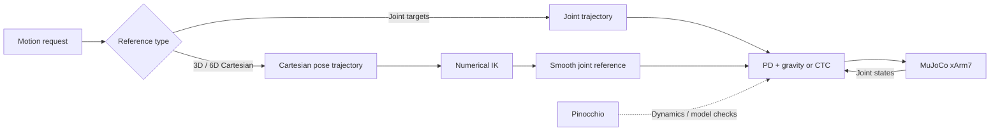
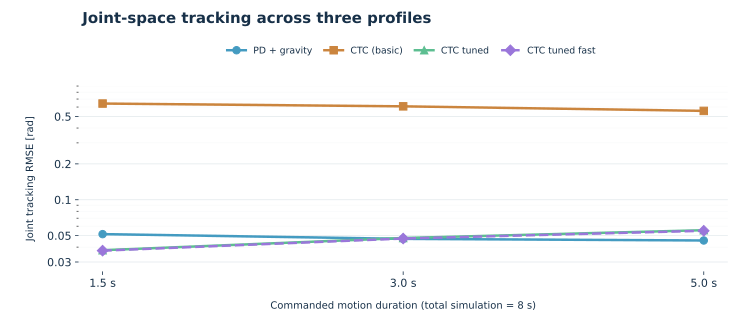
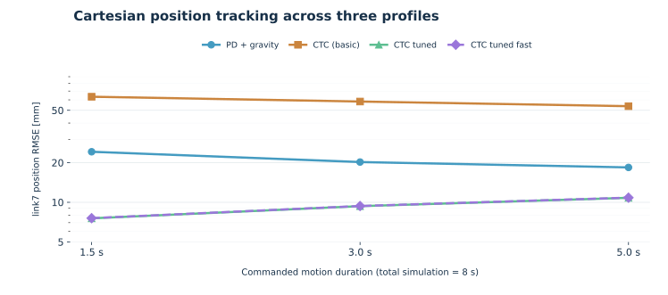

# xArm7 — Robot Control & Cartesian Motion Planning

**A reproducible, simulation-based study of 7-DOF robot dynamics, torque control and 3D/6D trajectory planning.**

[](environment.yml)
[](https://mujoco.org/)
[](https://github.com/stack-of-tasks/pinocchio)


**[Српски / Serbian](README.sr.md)** · **[Technical report](docs/xArm7_Tehnicki_izvjestaj_MuJoCo_Pinocchio_2026.docx)** · **[Results](docs/EXPERIMENTS_AND_RESULTS.md)** · **[References](docs/REFERENCES.md)**

> **Project scope.** MuJoCo simulates a fixed-base xArm7; Pinocchio is used for rigid-body dynamics and independent consistency checks. The work covers both joint-space torque controllers and independent Cartesian reference planning with numerical inverse kinematics. It is *not* a real-robot safety controller.

## Project at a glance

| Area | Implemented and tested |
|:--|:--|
| Robot model | Fixed-base xArm7, 7 actuated joints; MuJoCo model and URDF |
| Joint-space control | PD, PD + gravity compensation, computed torque (CTC), Pinocchio-based CTC variants |
| Direct Cartesian feedback | `cart_pos`, `cart_pose`, regularized inverse-dynamics example `cart_ctc` |
| Independent 3D planning | World-frame straight-line XYZ reference + numerical position IK |
| Independent 6D planning | XYZ line + SO(3) orientation interpolation + numerical pose IK |
| Verification | 12 unit tests passed; MuJoCo/Pinocchio dynamics checked at two states; functional 3D/6D simulation runs |

### How the components fit together



**Important distinction:** the independent 3D/6D planners generate a *joint reference* via IK, then track it using a *joint-space* torque controller. They do not implement direct Cartesian feedback. The direct Cartesian controllers are separate experiments.

## Quick start — Windows / Miniforge

From the repository root, with [Conda or Miniforge](https://github.com/conda-forge/miniforge) installed:

```bat
conda env create -f environment.yml
conda activate robotics
python -m unittest discover -s tests -v
python scripts\verify_models.py
```

Try the control and planning examples:

```bat
python scripts\run_experiment.py --controller pd_g
python scripts\run_experiment.py --controller ctc_tuned_fast
python scripts\run_cartesian_line.py --delta-xyz 0.02,0,0 --controller pd_g
python scripts\run_cartesian_pose.py --delta-xyz 0.02,0,0 --delta-rotvec-deg 0,0,5 --controller pd_g
```

Append `--view` to a simulation command to open the MuJoCo viewer. The `--delta-rotvec-deg` argument is a **world-frame rotation vector**, *not* Euler roll/pitch/yaw angles. Simulations save outputs under unique subdirectories of `results/`; generated files are ignored by Git.

## Control approaches

### Joint-space PD with gravity compensation

$$
\tau = K_p(q_d-q) + K_d(\dot q_d-\dot q) + g(q).
$$

`pd_g` is a useful baseline because it retains feedback and explicitly compensates the gravity torque. Gains in this repository were selected for the simulation model, not certified robot hardware.

### Computed torque (inverse dynamics)

$$
\tau = M(q)\left[\ddot q_d + 2\zeta\Omega(\dot q_d-\dot q)
+ \Omega^2(q_d-q)\right] + h(q,\dot q)-\tau_{\mathrm{passive}}.
$$

The tuned implementations also compensate MuJoCo's measured `qfrc_passive`. Coulomb `frictionloss` is solver-managed and is **not equivalent** to the passive-force term. The baseline `ctc` implementation differs from the tuned variants; see [Methods and limitations](docs/METHODS_AND_LIMITATIONS.md).

### Cartesian feedback and independent planning

Direct feedback methods are demonstrated in `cart_pos` (3D), `cart_pose` (6D) and `cart_ctc` (regularized inverse dynamics). Their responses depend on the modeled friction and the chosen gains. The separate `run_cartesian_line.py` and `run_cartesian_pose.py` scripts first solve sampled numerical IK, interpolate a smooth joint reference and then apply joint PD + gravity or tuned CTC. No collision check is performed.

## Experimental results

### Controlled 12-run joint benchmark

Four controllers were evaluated on three quintic reference durations (1.5, 3.0 and 5.0 seconds), each in an **8.0-second simulation**. The table reports the 3-second motion profile. Its RMSE values are calculated over the **full 8 seconds**, including the holding period.

| Method | Joint RMSE (rad) | `link7` position RMSE (mm) | Orientation RMSE (rad) |
|:--|--:|--:|--:|
| `pd_g` | 0.046911 | 20.219 | 0.031089 |
| `ctc` (baseline) | 0.608160 | 58.283 | 0.401459 |
| `ctc_tuned` | 0.047712 | **9.346** | 0.017321 |
| `ctc_tuned_fast` | 0.047206 | 9.370 | **0.014496** |

The results illustrate the effect of *specific gains, dynamics compensation and the tested reference*, rather than establishing a universal best controller. All four methods reported zero actuator-command saturation in this particular 3-second-profile trial.

<p align="center">
  <picture>
    <source media="(prefers-color-scheme: dark)" srcset="docs/figures/joint_rmse_dark.svg">
    
  </picture>
</p>

<p align="center">
  <picture>
    <source media="(prefers-color-scheme: dark)" srcset="docs/figures/tcp_rmse_dark.svg">
    
  </picture>
</p>

The charts use logarithmic vertical axes. Source: [curated 12-run CSV](docs/data/joint_controller_benchmark_20261026.csv). The benchmark launcher is [`scripts/compare_controllers.py`](scripts/compare_controllers.py); see also the [experiment protocol](docs/EXPERIMENT_PROTOCOL.md).

### Independent Cartesian path planning

All three examples used a +20 mm world-X translation, 151 numerical IK waypoints, a 3-second move and an 8-second simulation with `pd_g`:

| Planned reference | Maximum IK position residual | Final simulated position error | Final simulated orientation error |
|:--|--:|--:|--:|
| 3D XYZ line, orientation unconstrained | 0.0190 mm | 1.777 mm | Unconstrained (drift RMSE: 0.006760 rad) |
| 6D XYZ line, orientation fixed | 0.0189 mm | 1.775 mm | 0.002731 rad |
| 6D XYZ line, +5° world-Z rotation | 0.0189 mm | 1.780 mm | 0.002750 rad |

The small IK residuals measure *planning accuracy*. The millimetre-scale final errors measure *simulation tracking* and are not contradictory. All Cartesian positions refer to the **origin of `link7`**, not a calibrated tool-tip. Details: [3D planning](docs/CARTESIAN_LINE_V1.md) and [6D planning](docs/CARTESIAN_POSE_V1.md).

### Friction: a documented limitation

The model includes viscous damping and MuJoCo dry-friction constraints. Diagnostic friction compensation sometimes reduced pose error but caused continued joint-6 motion during hold; fading compensation suppressed motion but left more residual error on some goals. We preserve these findings rather than describing a universally stable friction compensator. See [results and interpretation](docs/EXPERIMENTS_AND_RESULTS.md).

## Repository structure

```text
xarm_control/         Reusable model, controller and planning modules
scripts/              Experiment, benchmark, verification and planning entrypoints
tests/                Automated numerical tests
models/               MuJoCo and URDF descriptions
meshes/               Robot geometry (third-party; see licensing note)
docs/                 Technical report, experiment protocol, references, figures and data
  data/               Curated benchmark CSV
  figures/            Curated benchmark charts
results/              Generated locally (ignored by Git)
environment.yml       Conda dependencies
README.sr.md          Serbian-language project overview
```

## Documentation and scientific basis

- [Complete technical report (Word)](docs/xArm7_Tehnicki_izvjestaj_MuJoCo_Pinocchio_2026.docx)
- [Methods, assumptions and limitations](docs/METHODS_AND_LIMITATIONS.md)
- [Experimental protocol](docs/EXPERIMENT_PROTOCOL.md) · [Curated results](docs/EXPERIMENTS_AND_RESULTS.md)
- [Numerical 3D planning](docs/CARTESIAN_LINE_V1.md) · [Numerical 6D planning](docs/CARTESIAN_POSE_V1.md)
- [Bibliography and method-to-source map](docs/REFERENCES.md)

The **primary theoretical reference** is *Robotics: Modelling, Planning and Control* (Siciliano, Sciavicco, Villani and Oriolo, Springer, 2009), especially Chapters 2–4 and 7–8. *Robot Modeling and Control*, 2nd edition (Spong, Hutchinson and Vidyasagar, Wiley, 2020) is the complementary text. Relevant journal papers include Khatib (1987) on operational-space control, Yoshikawa (1985) on manipulability, and Armstrong-Hélouvry *et al.* (1994) on friction. Full citations and DOIs are in [`docs/REFERENCES.md`](docs/REFERENCES.md).

## Model attribution and release conditions

The original Python code is licensed under BSD-3-Clause (see [LICENSE](LICENSE)). The xArm URDF and mesh files are third-party assets with separate attribution and licensing requirements. All eight visual STL meshes and eight collision OBJ meshes have been SHA-256 verified against pinned upstream revisions: MuJoCo Menagerie commit `98a70c569c4c1b6da467a20012f766ee1f8dc521` and UFACTORY xarm_ros commit `cf51617d98bc55a88d9aa735acfa43a0bbb8e425`. The URDF inertial and kinematic parameters also match the checked UFACTORY configuration, but local joint effort limits differ and the exact historical URDF-generation revision remains unknown. See [third-party notices](docs/THIRD_PARTY_NOTICES.md) and [attribution review](docs/ATTRIBUTION_REVIEW.md). Redistribution review and fresh-clone testing remain open; keep the repository private until these checks are completed.

**Scope limits:** no validated hardware actuation, collision avoidance, physical TCP calibration, full workspace IK coverage, real-world friction identification or certified safety behavior. The reported numerical results are for the stated simulation setup only.
