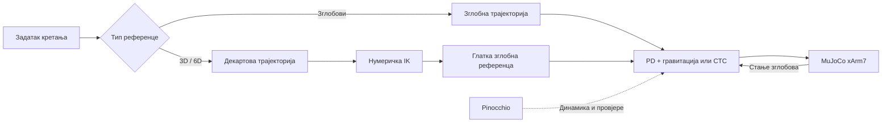
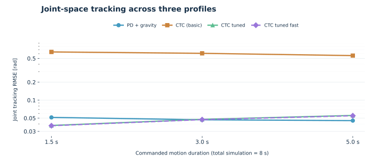
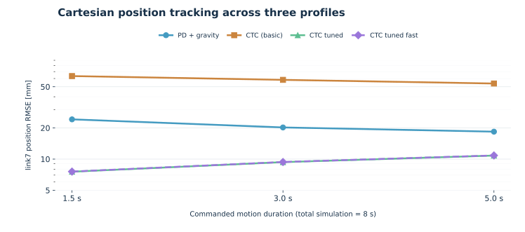

# xArm7 — управљање роботом и планирање Декартових трајекторија

**Репродуктиван симулациони пројекат: динамика седмоосног робота, моментно управљање и независно планирање 3D/6D трајекторија.**

[](environment.yml)
[](https://mujoco.org/)
[](https://github.com/stack-of-tasks/pinocchio)


**[English / енглески](README.md)** · **[Технички извјештај](docs/xArm7_Tehnicki_izvjestaj_MuJoCo_Pinocchio_2026.docx)** · **[Резултати](docs/EXPERIMENTS_AND_RESULTS.md)** · **[Литература](docs/REFERENCES.md)**

> **Предмет рада.** MuJoCo симулира фиксно постављен робот xArm7 са седам степени слободе. Pinocchio служи за прорачун динамике крутих тијела и независну провјеру модела. Пројекат обухвата управљање у простору зглобова, Декартово управљање и независно планирање 3D/6D трајекторија са нумеричком инверзном кинематиком. Није намијењен безбједном директном управљању стварним роботом.

## Преглед реализованог

| Област | Реализација |
|:--|:--|
| Модел робота | Фиксна база, седам зглобова са моментним актуаторима; MuJoCo модел и URDF |
| Зглобно управљање | PD, PD са компензацијом гравитације, CTC и Pinocchio варијанте |
| Директно Декартово управљање | `cart_pos`, `cart_pose`, `cart_ctc` (регуларизована инверзна динамика) |
| Независно 3D планирање | Права линија XYZ у свјетском координатном систему и нумеричка IK позиције |
| Независно 6D планирање | XYZ линија, интерполација оријентације на SO(3) и нумеричка IK позе |
| Провјере | 12 успјешних јединичних тестова, поређење динамике у двије конфигурације и функционални 3D/6D експерименти |

### Повезаност компоненти



**Важно:** независни 3D/6D планери преко инверзне кинематике генеришу *зглобну референцу*, коју потом прати *зглобни* моментни контролер. То није исто што и директна затворена петља управљања Декартовом позом; директни Декартови контролери су одвојена цјелина.

## Покретање — Windows / Miniforge

У основном директоријуму репозиторијума, након инсталације [Conda или Miniforge](https://github.com/conda-forge/miniforge):

```bat
conda env create -f environment.yml
conda activate robotics
python -m unittest discover -s tests -v
python scripts\verify_models.py
```

Покретање основних примјера:

```bat
python scripts\run_experiment.py --controller pd_g
python scripts\run_experiment.py --controller ctc_tuned_fast
python scripts\run_cartesian_line.py --delta-xyz 0.02,0,0 --controller pd_g
python scripts\run_cartesian_pose.py --delta-xyz 0.02,0,0 --delta-rotvec-deg 0,0,5 --controller pd_g
```

Опција `--view` отвара MuJoCo приказ. Параметар `--delta-rotvec-deg` представља **вектор ротације у свјетском координатном систему**, а не Ојлерове углове. Резултати се чувају у јединственим потдиректоријумима `results/`, који се не шаљу на GitHub.

## Методе управљања

### PD са компензацијом гравитације

$$
\tau = K_p(q_d-q) + K_d(\dot q_d-\dot q) + g(q).
$$

Контролер `pd_g` представља почетну референтну методу. Параметри су подешени за симулациони модел и нису верификовани за стварни робот.

### CTC — управљање засновано на инверзној динамици

$$
\tau = M(q)\left[\ddot q_d + 2\zeta\Omega(\dot q_d-\dot q)
+ \Omega^2(q_d-q)\right] + h(q,\dot q)-\tau_{\mathrm{passive}}.
$$

Подешене варијанте компензују и `qfrc_passive` из MuJoCo-а. Суво трење `frictionloss` третира се као ограничење у нумеричком рјешавачу и не припада том пасивном члану. Основни CTC и подешене варијанте зато се не могу тумачити као идентичне методе са само промијењеним појачањима. Детаљи су у [методологији](docs/METHODS_AND_LIMITATIONS.md).

### Декартово управљање и независно планирање

`cart_pos`, `cart_pose` и `cart_ctc` су примјери директног Декартовог управљања. Насупрот томе, `run_cartesian_line.py` и `run_cartesian_pose.py` прво израчунавају дискретну нумеричку IK, затим глатку зглобну трајекторију и коначно прате кретање зглобним PD+G или CTC контролером. У овим планерима **није реализована провјера судара**.

## Експериментални резултати

### Поређење четири контролера у 12 експеримената

Поређена су четири контролера на квинтичким трајекторијама трајања 1,5 s, 3 s и 5 s. Сваки експеримент има укупно **8 s симулације**. У табели су резултати за кретање од 3 s, док је RMSE израчунат током **цијелих 8 s**, укључујући задржавање завршне позе.

| Контролер | RMSE зглобова (rad) | RMSE позиције `link7` (mm) | RMSE оријентације (rad) |
|:--|--:|--:|--:|
| `pd_g` | 0,046911 | 20,219 | 0,031089 |
| `ctc` (основни) | 0,608160 | 58,283 | 0,401459 |
| `ctc_tuned` | 0,047712 | **9,346** | 0,017321 |
| `ctc_tuned_fast` | 0,047206 | 9,370 | **0,014496** |

Ови резултати показују утицај конкретних појачања, компензације динамике и одабране референце. Они не доказују да је један контролер најбољи у свим условима. За приказани профил сва четири контролера имала су нула засићења командованих момената.

<p align="center">
  <picture>
    <source media="(prefers-color-scheme: dark)" srcset="docs/figures/joint_rmse_dark.svg">
    
  </picture>
</p>

<p align="center">
  <picture>
    <source media="(prefers-color-scheme: dark)" srcset="docs/figures/tcp_rmse_dark.svg">
    
  </picture>
</p>

Графикони користе логаритамску вертикалну осу. Подаци су у [CSV табели 12 експеримената](docs/data/joint_controller_benchmark_20261026.csv); скрипта [`compare_controllers.py`](scripts/compare_controllers.py) покреће benchmark. Погледати и [протокол](docs/EXPERIMENT_PROTOCOL.md).

### Независно Декартово планирање

У три функционална експеримента реализовано је помјерање +20 mm по свјетској X оси, са 151 IK тачком и 3 s кретања током 8 s симулације, уз `pd_g`.

| Референца | Највећа позициона IK грешка | Коначна грешка позиције | Коначна грешка оријентације |
|:--|--:|--:|--:|
| 3D XYZ линија, слободна оријентација | 0,0190 mm | 1,777 mm | Није задата (RMSE заношења: 0,006760 rad) |
| 6D XYZ линија, фиксна оријентација | 0,0189 mm | 1,775 mm | 0,002731 rad |
| 6D XYZ линија, ротација +5° око свјетске Z осе | 0,0189 mm | 1,780 mm | 0,002750 rad |

Мала IK грешка оцјењује *планирање*, док милиметарска грешка симулације оцјењује *динамичко праћење*. Све позиције се односе на **почетак тијела `link7`**, а не на физички калибрисан врх алата. Детаљи: [3D](docs/CARTESIAN_LINE_V1.md) и [6D](docs/CARTESIAN_POSE_V1.md).

### Ограничења због трења

Симулациони модел садржи вискозно пригушење и ограничење сувог трења. Дијагностичка компензација понекад је смањивала грешку оријентације, али је могла изазвати дуготрајно кретање шестог зглоба при задржавању позе. Постепено искључивање компензације смањивало је кретање, уз преосталу грешку позе. Ови налази су документовани, а не представљени као универзално стабилан алгоритам. [Анализа](docs/EXPERIMENTS_AND_RESULTS.md).

## Структура репозиторијума

```text
xarm_control/         Основни модули, контролери и планери
scripts/              Примјери, benchmark и провјере
tests/                Аутоматски нумерички тестови
models/               MuJoCo и URDF опис робота
meshes/               Геометрија робота (туђа права, видјети напомену)
docs/                 Технички извјештај, протокол, литература, графикони, подаци
  data/               Одабрана CSV табела
  figures/            Одабрани графикони
results/              Локално генерисани резултати (Git их игнорише)
environment.yml       Conda окружење
README.md             Енглеска верзија
```

## Документација и литература

- [Технички извјештај у Word формату](docs/xArm7_Tehnicki_izvjestaj_MuJoCo_Pinocchio_2026.docx)
- [Методе и ограничења](docs/METHODS_AND_LIMITATIONS.md)
- [Експериментални протокол](docs/EXPERIMENT_PROTOCOL.md) · [Резултати](docs/EXPERIMENTS_AND_RESULTS.md)
- [3D планер](docs/CARTESIAN_LINE_V1.md) · [6D планер](docs/CARTESIAN_POSE_V1.md)
- [Потпуна библиографија](docs/REFERENCES.md)

**Главни теоријски извор** је *Robotics: Modelling, Planning and Control* (Siciliano, Sciavicco, Villani и Oriolo, Springer, 2009), нарочито поглавља 2–4 и 7–8. Као допуна користи се *Robot Modeling and Control*, друго издање (Spong, Hutchinson и Vidyasagar, Wiley, 2020). Од часописних радова наведени су Khatib (1987), Yoshikawa (1985) и Armstrong-Hélouvry са коауторима (1994). Потпуни подаци и DOI су у [`docs/REFERENCES.md`](docs/REFERENCES.md).

## Поријекло модела и услови објављивања

Оригинални Python код објављује се под BSD-3-Clause лиценцом (видјети [LICENSE](LICENSE)). xArm URDF и геометријске датотеке представљају ресурсе треће стране, са засебним условима лиценцирања и навођења поријекла. Свих осам визуелних STL и осам колизионих OBJ датотека провјерено је SHA-256 поређењем са фиксним ревизијама званичних репозиторијума: MuJoCo Menagerie (`98a70c569c4c1b6da467a20012f766ee1f8dc521`) и UFACTORY xarm_ros (`cf51617d98bc55a88d9aa735acfa43a0bbb8e425`). Потврђено је и подударање инерцијалних и кинематичких параметара URDF модела са провјереном UFACTORY конфигурацијом. Ограничења момента у локалном URDF-у се разликују, а тачна историјска ревизија из које је првобитно генерисан URDF није утврђена. Детаљи су наведени у [напоменама о ресурсима трећих страна](docs/THIRD_PARTY_NOTICES.md) и [провјери атрибуције](docs/ATTRIBUTION_REVIEW.md). Провјера услова редистрибуције и тестирање из чисте Git копије још нису завршени. До тада репозиторијум треба да остане приватан.

**Границе примјене:** нема верификације стварног хардвера, провјере судара, калибрације физичког TCP-а, гаранције достижности свих поза, идентификације стварног трења ни сертификоване безбједности. Приказани резултати односе се искључиво на наведени симулациони модел.
